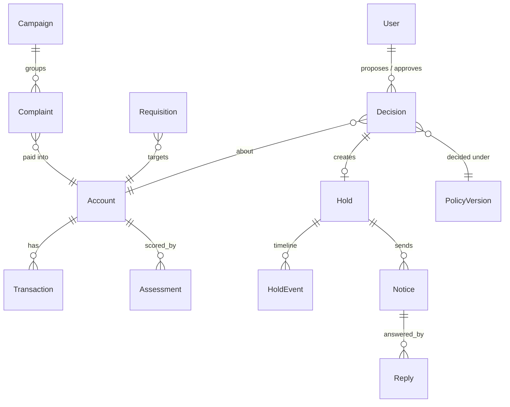

# Scalpel — Architecture Plan

> **Stop the money. Spare the innocent. Prove you followed the rules.**

| | |
|---|---|
| **Project** | Scalpel, a Tech Mahindra internship project (solo) |
| **Status** | Plan for review. Nothing below is final until Shankar approves it. |
| **Target dates** | Submit **28 Dec 2026** (hard deadline 30 Dec) |
| **Data** | Simulation only: fictional "Bharat Demo Bank" and "Telco-A". No real personal data anywhere. |

---

## Contents

1. [What Scalpel is](#1-what-scalpel-is)
2. [Who uses it](#2-who-uses-it)
3. [The big picture](#3-the-big-picture)
4. [The building blocks](#4-the-building-blocks)
5. [How data flows](#5-how-data-flows)
6. [Data model](#6-data-model)
7. [Tech stack, and why](#7-tech-stack-and-why)
8. [Folder layout](#8-folder-layout)
9. [How we check it works (validation, in plain language)](#9-how-we-check-it-works-validation-in-plain-language)
10. [Build milestones](#10-build-milestones)
11. [Who does what](#11-who-does-what)
12. [Risks, and what we cut first](#12-risks-and-what-we-cut-first)
13. [Open items before building](#13-open-items-before-building)
14. [Glossary](#14-glossary)

---

## 1. What Scalpel is

When a cyber-fraud complaint or a police request reaches a bank or a telecom company, staff must decide quickly **what to freeze, how much, under which rule, and for how long**. Today the common answer is "freeze the whole account", which hurts innocent people (for example a shopkeeper who unknowingly received scam money) and can hold many times more money than was actually stolen (in our own simulated worlds, about 15 times; no industry figure is quoted).

Scalpel is a decision and tracking tool for those staff. For every case it:

1. **Traces** where the stolen money really is, down to the paisa and across several hops.
2. **Checks** every proposed action against three questions, shown as three badges on every decision:
   - ✅ **Allowed?** Does the law and the requester's authority permit this action in this state?
   - ✅ **Right size?** Is the hold no bigger than the stolen money actually traced to this account?
   - ✅ **On time?** Are all legal deadlines being met?
3. **Tracks deadlines** for every hold and releases or escalates automatically.
4. **Tells the account holder** how much is held, why, and how to contest it (the hold memo's contest section; the portal and Hindi were cut in phase 3).
5. **Proves** to auditors and courts that each step was lawful and proportionate, with a tamper-proof record.

The headline number is the **Freeze Ratio**: money held ÷ money actually traced. Scalpel aims for about 1×. We quote only ratios measured in our own simulation; no industry-wide figure is cited because none has a public source.

**What Scalpel is not:** it is not connected to any real bank, police or telecom system, and it is not legal advice. Every screen shows the banner *"Simulation with fictional data. Not legal advice."*, and every generated document carries the watermark *"SIMULATION – NOT AN OFFICIAL ORDER"*.

---

## 2. Who uses it

| User | What they do in Scalpel |
|---|---|
| **Fraud officer (maker)** | Works the inbox, traces money, proposes actions |
| **Supervisor (checker)** | Approves or rejects big actions (two-person rule) |
| **Compliance / auditor** | Reads the fairness report, rule versions, audit log and evidence packs |
| **Account holder** | Uses the portal: why am I on hold, how much, until when; sends an explanation |
| **Telco fraud analyst** | Requests number or handset blocks, checked against the same rules |
| **Police officer** | *Simulated only.* Their requests arrive in the inbox. |
| **Admin** | Manages users, resets the demo, moves the "time travel" clock for demos |

---

## 3. The big picture

```mermaid
flowchart TB
  subgraph OUT["Outside world (simulated)"]
    P[Police requests]
    V[Victim complaints]
    T[Telco network signals<br/>SIM swap, call forwarding, risk tier]
  end

  subgraph APP["Scalpel web app (Next.js on Vercel)"]
    UI[Screens<br/>Inbox · Case & Trace · Decide · Holds ·<br/>Portal · Telco · Assure · Verify]
    API[REST API /api/v1<br/>+ public docs]
    JOB[Daily deadline job]
    ENG[Engine: pure logic<br/>trace · request check · gate · score · clocks · audit]
    RB[(Rulebook<br/>YAML files)]
    AD[Adapters / plugs<br/>CoreBanking · Telco · Network API ·<br/>Police feed · Notifier]
  end

  DB[(Postgres on Neon<br/>cases, holds, events, audit chain)]
  BLOB[(Vercel Blob<br/>evidence-pack PDFs)]
  PIPE[Data + AI pipeline (Python, offline)<br/>fake world → model → risk scores + reasons]
  TRUTH[(truth.json<br/>hidden answers, grading only)]

  P --> API
  V --> API
  T --> AD
  UI --> API
  API --> ENG
  JOB --> ENG
  ENG --> RB
  API --> AD
  API --> DB
  JOB --> DB
  API --> BLOB
  PIPE -->|load demo data| DB
  PIPE -. writes .-> TRUTH
  TRUTH -. used only to grade results .-> PIPE
```

**In one sentence:** requests and complaints come in, the engine works out what is allowed and how much to hold using the rulebook, people approve, the plugs carry out the action, the clocks keep it on time, and every step is written to a tamper-proof log.

**Key design rules**

- **The engine is pure calculation.** It has no database and no internet. That makes it easy to test thoroughly and to reuse.
- **The law lives in files, not in code.** When a rule changes, we edit a YAML file, and Scalpel can show what changed and which holds are affected.
- **Plugs at the edges.** Everything that would talk to a real bank, telco or police system goes through an adapter. Today those are mocks. A real bank would swap the plugs and keep the rest.
- **The decision code never sees the answers.** Who is *really* a mule is kept in a separate file (`truth.json`) that the Gate and Scorer are not allowed to read. It is used only to grade how well Scalpel did.

---

## 4. The building blocks

### A. Engine (`packages/engine`) — the brain

Pure TypeScript functions with automatic tests.

| Module | What it does | State |
|---|---|---|
| `money` | Stores all money as whole paise, so there are no rounding errors | Done (tested) |
| `time` | Indian Standard Time calendar days; deadlines end at 23:59:59.999 IST; Day 0 is the event day | Done (tested) |
| `jurisdiction` | Maps cases to states and picks the strictest rule for cross-state cases | Done (tested) |
| `policy` | Loads the rulebook YAML, with dates and state overlays | Done (tested) |
| `trace` (**Rolling Charge**) | Follows each victim's money through mixed accounts and several hops, and says how much stolen money is really in each account and whose it is | Done (tested) |
| `requisition` | Checks a police request against a 5-point checklist (signature and rank, FIR/NCRP number, exact amount, Magistrate within 24 hours, civil vs criminal) and drafts a memo back | Done (tested) |
| `gate` | Checks every proposed action (Allowed? Right size? On time?) and can **allow**, **modify** (e.g. whole freeze → exact hold), **route** (to a Magistrate or back to the officer) or **deny** | Done (tested) |
| `score` | Weighs money saved against harm to innocent people, with one "how cautious" slider | Done (tested) |
| `lifecycle` | Runs the deadline clocks for every hold: alerts, automatic release, bank-to-police handover, one +90-day extension | Done (tested) |
| `audit` | Tamper-proof hash chain plus a case fingerprint (Merkle root); the same check runs in the browser | Done (tested) |
| `campaign` | Groups complaints that paid the same account and ranks them by "golden hour" urgency | Done (tested) |
| `restoration` | Splits returned money back to each victim in the right share | Done (phase 1) |
| `policy-diff` | Compares old and new rules and lists which holds are affected | To add |
| `fairness` | Freeze Ratio, innocent money held, broken down by group | Done (phase 1) |
| `replay` | Runs Court Replay cases through the engine | To add |

> "Done (tested)" means the module is in the repository with automatic tests (79 engine tests passing after phase 1, 23 Nov 2026). Rule values and citations stay labelled "unverified" until research R1 checks them.

**The Gate rules (R1–R9)**

| Rule | Plain meaning |
|---|---|
| R1 | An exact hold can never be more than the money traced to the account. |
| R2 | Freezing a whole account is a last resort: mule score ≥ 0.85, at least 2 signals, and an officer confirms. |
| R3 | A hold lasts at most 60 days unless a court extends it. |
| R4 | Amounts under ₹50,000 go to fast restoration (unverified: press reports it; R1 did not find it in the SOP text). |
| R5 | Never block the 140 / 1600 / 1601 number series (official and banking numbers). |
| R6 | Never block a spoofed displayed number (the real caller is someone else). |
| R7 | A SIM or handset block needs at least 2 signals, including at least 1 telecom signal. |
| R8 | "Shields" (likely innocent receivers) get an exact hold and a notice only. |
| R9 | Every action needs an evidence record. |

**Who may freeze, by state.** High Courts disagree on whether police can order a debit freeze themselves:

- Bombay, Kerala and Delhi: police cannot, so the request is routed to a Magistrate.
- Karnataka: police can.
- States with no ruling yet: the strict default applies, and the case is flagged.
- Cross-state cases: the strictest applicable rule wins.

All case names and rules are labelled **"unverified"** until research prompt R1 confirms them.

### B. Rulebook (`policies/`) — the law as editable files

Each rule records its **source**, its **status** (final / draft / contested / assumed) and its **start date**. National rules sit in one file; state court rulings are "overlays" on top. Deadline clocks are data too, for these regimes:

| Regime | What it covers |
|---|---|
| `RBI_BANK` | A bank's own fraud hold |
| `MHA_POLICE` | A hold ordered by police |
| `NPCI_CHARGEBACK` | UPI chargeback timelines |
| `DIGITAL_SUSPENSION` | The 45-day suspension of digital access |
| `COURT_ORDER` | A hold ordered or extended by a court |
| `TRAI_UCC` | Telecom spam and fraud-call rules |

### C. Data + AI pipeline (`pipeline/`, Python) — the fake world

Runs offline and loads its output into the database.

- **People:** victims, mule accounts, "shields" (innocent shopkeepers or gig workers who unknowingly received scam money) and normal customers.
- **Scams:** investment, "digital arrest", KYC update, part-time job. Money moves through 3–5 hops, then out as cash, crypto or gold.
- **Telecom signals:** SIM swaps, call forwarding, SIM boxes, phone-number risk tiers.
- **Two worlds:** **v1** for building, and a deliberately different **v2** used only for honest testing.
- **AI model:** LightGBM sorts each account into mule / shield / normal and gives its **top 3 reasons** in plain words (via SHAP).
- **Hidden truth:** written to `truth.json`, kept apart from the decision code.
- **Time box:** at most 1.5 days of work, so it cannot eat the schedule.

### D. Web app (`apps/web`, Next.js) — eight areas

> **Phase 3 (24 Nov) built the proof screens first:** Headline (two-number headline + show-the-math), "Same 30 days, four ways" replay, the printable Hold memo (engine badges, clocks, contest section, Officer proposes / Supervisor approves) and "Who first?" (order chart + locked split-payment world). They are a static site built from one data file, `apps/web/data/demo.json`.
> **Cut (screens only, no rules removed):** the Account-holder Portal, Hindi, the Telco console and real login. Rules R5–R7, the 6 phone clues, the TRAI clock and their tests stay. Login is replaced by **demo roles** that keep two-person approval for a whole freeze. Areas 1–4 and 7–8 below are later phases.

1. **Inbox:** new complaints and police requests, grouped into campaigns, sorted by golden-hour urgency, each request marked valid / defective.
2. **Case & Trace:** money-flow graph; for each account, how much stolen money is really there and whose it is; a comparator showing what each tracing method would freeze.
3. **Decide:** the decision card with the three badges; every rule check with its source; court-objection risks before and after; money saved vs harm; the officer proposes, the supervisor approves; overrides need a written reason.
4. **Holds:** the Clock Board with every hold's deadlines, alerts, automatic releases, extension requests and notices.
5. ~~Account-holder Portal (English + Hindi)~~ **cut in phase 3.** The hold memo carries the notice and how to contest.
6. ~~Telco console~~ **cut in phase 3 (screen only).** The telecom rules and the TRAI clock stay in the engine with their tests.
7. **Assure (for auditors):** Freeze Ratio dashboard; fairness report; rule versions and simulator; rule-change diff; Court Replay results; audit log; one-click evidence pack; the "Where Scalpel loses" page; regulator CSV export.
8. **Public pages:** landing story; **/verify** (drop in an evidence pack and your own browser checks it); API docs.

### E. API (`/api/v1`)

How other systems would talk to Scalpel: send in a police request, read a case, submit a decision, record a hold event, download an evidence pack. Every input is checked with zod, and the same schemas generate the public OpenAPI documentation.

### F. Database (Postgres on Neon, via Prisma)

See [section 6](#6-data-model).

### G. Automatic jobs

- **Daily deadline job:** checks every hold's clocks, sends alerts, auto-releases, hands bank holds over to police, and writes each step to the audit chain.
- **Time travel:** for demos, an admin can move the clock forward to show deadlines firing.
- **Nightly reset:** demo data resets every night so the live link always works.

### H. Adapters (plugs)

| Plug | Real-world equivalent | Today |
|---|---|---|
| CoreBanking | Place or release a hold | Mock |
| Telco | Block or unblock a number or handset | Mock |
| Network API | SIM swap and call-forwarding checks, in the CAMARA API format | Mock |
| Police feed | Incoming requests | Mock |
| Notifier | SMS / email | Shown in an "Outbox" screen; nothing is really sent |

### I. Security and privacy

- Demo roles (Officer, Supervisor), not real login; two-person approval for a whole freeze stays.
- Account and phone numbers masked; "reveal with reason" is logged.
- Input checks on everything.
- Data-retention job, with "deletion deferred: legal obligation" for records under legal hold (DPDP Act).
- Fake identifiers only: phone numbers look like `+91 0XXXX XXXXX`, IMEIs start with `00`.

### J. Honesty layer

- Hidden-truth separation (`truth.json`).
- Court Replay done fairly: rules are frozen first (`gate-v1` tag), then tested on cases nobody looked at while building.
- "Assumed / unverified" labels on any rule or citation not yet checked.
- A "Where Scalpel loses" page that shows weaknesses openly.

### K. Hosting (free tiers only)

| Service | Used for |
|---|---|
| Vercel | Website, API and daily job |
| Neon | Postgres database |
| Vercel Blob | Evidence-pack PDFs |
| GitHub Actions | Runs all tests on every push |

If the database is ever down, the site shows a saved snapshot so the demo never breaks.

---

## 5. How data flows

### 5.1 One case, start to finish

```mermaid
sequenceDiagram
  autonumber
  participant Victim
  participant Inbox
  participant Engine
  participant Officer
  participant Supervisor
  participant Bank as CoreBanking plug
  participant Holder as Account holder
  participant Audit

  Victim->>Inbox: Reports ₹60,000 scam (10:02)
  Inbox->>Engine: Group with 2 other complaints to the same account
  Engine->>Engine: Trace: ₹30,000 in Mule-1, ₹20,000 in Mule-2, split by victim
  Note over Inbox,Engine: Police request asks to "freeze the whole account"
  Engine->>Officer: Request checker: DEFECTIVE (no exact amount), memo drafted
  Engine->>Officer: Gate: whole freeze → exact ₹30,000 hold, 3 badges green
  Officer->>Supervisor: Proposes the hold
  Supervisor->>Bank: Approves, plug places the hold
  Bank->>Holder: Plain-language notice, 20-day clock starts
  Holder->>Inbox: Uploads invoices through the portal
  Officer->>Bank: Release or keep; money split back to victims
  Engine->>Audit: Every step chained; evidence pack ready for /verify
```

1. **10:02** A victim reports a ₹60,000 scam. It lands in the **Inbox**, grouped with 2 other complaints that paid the same account.
2. **Trace:** Rolling Charge finds ₹30,000 still in Mule-1 and ₹20,000 in Mule-2, split by victim.
3. **Police request** arrives asking to "freeze the whole account". The **request checker** flags it as defective (no exact amount) and drafts a memo back.
4. **Gate:** whole freeze → **exact ₹30,000 hold**. The state rule is checked and the bank's own signals are strong enough. All three badges are green.
5. **Two-person approval:** the officer proposes, the supervisor approves, and the **CoreBanking plug** places the hold.
6. **Notice:** the account holder gets a plain-language notice. The **20-day** explanation clock starts on the Clock Board.
7. **Portal:** the account holder (an innocent shopkeeper) uploads invoices. A decision is due within 10 days.
8. **Release:** the hold is released or kept. Money is split back to victims in the right shares.
9. **Audit:** every step is in the tamper-proof chain. One click produces the **court evidence pack**, which anyone can check on **/verify**.
10. **Assure:** the Freeze Ratio and fairness report update automatically.

### 5.2 Where each kind of data goes

| Data | Comes from | Stored in | Read by | Never read by |
|---|---|---|---|---|
| Fake accounts and transactions | Pipeline (v1 / v2 world) | Postgres | Engine (via API), screens | — |
| Risk scores + top-3 reasons | Pipeline (AI model) | Postgres (`Assessment`) | Gate, Scorer, Decide screen | — |
| Hidden truth (who is really a mule) | Pipeline | `truth.json`, outside the app | Grading scripts only | Gate, Scorer, web app |
| Rules and clocks | `policies/*.yaml` | Repo (versioned) + `PolicyVersion` table | Engine | — |
| Decisions and hold events | Officers, supervisors, daily job | Postgres | Clock Board, Assure | — |
| Audit entries | Every write | Postgres (hash chain) | Assure, evidence pack, /verify | Nothing may edit them |
| Evidence-pack PDFs | Assure | Vercel Blob | Auditors, /verify | — |

---

## 6. Data model

Main tables (Prisma models). Money is always stored as whole paise in an integer column.

| Group | Tables |
|---|---|
| People and organisations | `Organisation`, `User` (with role) |
| Money | `Account`, `Transaction` |
| Intake | `Complaint`, `Campaign`, `Requisition` (police request) |
| Decisions | `Assessment` (AI score + reasons), `Decision`, `Hold`, `HoldEvent` |
| Account holder | `Notice`, `Reply` / `Document` |
| Proof | `AuditEntry`, `PolicyVersion` |
| Testing | `ReplayCase`, `ReplayResult` |
| Telecom | `TelcoNumber`, `TelcoAction` |



`AuditEntry` links to every table above: each row stores the hash of the previous entry, so the log is a chain.

---

## 7. Tech stack, and why

| Part | Tool | Why |
|---|---|---|
| Language | **TypeScript** (web + engine), **Python** (data/AI) | Type safety catches mistakes early; Python is standard for ML |
| Workspace | **pnpm workspaces** | Engine and web app live in one repo and share code |
| Web | **Next.js 14 + Tailwind** | Screens and API in one project; free hosting on Vercel |
| Database | **Postgres (Neon) + Prisma** | Free, reliable, and database access is typed |
| Money-flow graph | **Cytoscape.js** | Good for drawing account-to-account flows |
| Login | none (demo roles) | Cut in phase 3; the two-person rule is kept in the screens |
| Validation and API docs | **zod + OpenAPI + Redoc** | One schema checks input *and* generates the docs |
| Rule files | **js-yaml** | Readable rulebook files |
| Tests | **Vitest, fast-check, Playwright** | Unit tests, "random world" tests, and real-browser tests |
| AI | **LightGBM + SHAP** | Fast, works well on table data, and explains itself ("top 3 reasons") |
| Hosting | **Vercel, Neon, Vercel Blob, GitHub Actions** | All free tiers |

---

## 8. Folder layout

```
Scalpel/
├─ packages/
│  └─ engine/              the brain: pure TypeScript logic + tests
│     ├─ src/              money, time, jurisdiction, policy, trace, requisition,
│     │                    gate, score, lifecycle, audit, campaign, ...
│     └─ test/             unit, property ("random world") and golden tests
├─ policies/               rulebook YAML
│  ├─ national/            national rules and clocks
│  ├─ states/              state High Court overlays
│  └─ sources.yaml         where each rule comes from, with status labels
├─ pipeline/               Python: fake world v1/v2, AI model, exports, grading
├─ replay/                 Court Replay cases, coding sheet, runner
├─ apps/
│  └─ web/                 Next.js app
│     ├─ app/              screens and /api/v1 routes
│     ├─ prisma/           database schema and seed scripts
│     ├─ adapters/         CoreBanking, Telco, Network API, Police, Notifier mocks
│     └─ jobs/             daily deadline job, nightly reset
├─ e2e/                    real-browser tests of the key journeys
├─ docs/                   this plan, limitations, "Where Scalpel loses"
├─ .github/workflows/      automatic tests on every push
├─ CLAUDE.md               working notes and key decisions
├─ package.json / pnpm-workspace.yaml
└─ LICENSE
```

---

## 9. How we check it works (validation, in plain language)

Every check below runs automatically on GitHub every time code is pushed. If any check fails, the change is marked with a red ✗ and we fix it before moving on.

### 9.1 Engine tests — "does each calculation give the right answer?"

- **Unit tests.** Small, hand-written examples with a known answer. *Example:* an account had ₹40,000 of its own money, received ₹60,000 stolen, spent ₹50,000 and then got a salary. Rolling Charge must say exactly ₹30,000 of stolen money is left. If the code says anything else, the test fails.
- **"Random world" tests (property tests).** The computer invents thousands of random worlds of accounts and payments and checks rules that must *always* be true, for example:
  - Scalpel never holds more than the account balance.
  - Every rupee of victim money is accounted for, down to the paisa.
  - Changing or reordering one audit record is always detected.
  This finds odd cases nobody would think to write by hand. The earlier draft already passed 2,000 random worlds.
- **Golden tests.** A few cases shaped like real court cases, with the answer agreed in advance. If a later change alters one of these answers, we notice immediately.

**Pass means:** every test green, and the type checker (`tsc`) reports no errors.

### 9.2 API tests — "does the front door accept good input and reject bad input?"

We send correct and incorrect requests to each API route and check the replies. *Example:* a police request with no amount must be accepted but marked **defective**; a request with a negative amount must be refused outright.

**Pass means:** every route returns the expected answer and status code.

### 9.3 Browser tests — "can a real user complete the key tasks?"

A robot (Playwright) opens the real website in a browser, clicks through it like a person, and checks what appears on screen. Five journeys:

1. Complaint arrives → traced → exact hold placed.
2. Defective police request → memo back to the officer.
3. Hold → the memo shows how the holder contests → the engine's lifecycle tests cover review and release (the portal screen was cut).
4. Deadline passes → automatic release (using time travel).
5. Evidence pack downloaded → checked on /verify → then one byte is changed and /verify must say **tampered**.

**Pass means:** all five journeys finish with the expected screen.

### 9.4 Model check — "is the AI honest, not just lucky?"

- The model is trained on world **v1** and tested on world **v2**, which it has never seen and which is built differently on purpose. This is like testing a student on a new exam instead of the practice paper.
- Its results are compared with a simple baseline: "always use an exact hold, no AI". If the AI does not beat the baseline, we say so.
- Results come from `truth.json`, which the decision code never reads, so Scalpel cannot "cheat" by peeking at the answers.

**Pass means:** the scores are reported honestly on v2, including where the model loses.

### 9.5 Court Replay — "would Scalpel's decisions have held up?"

- We take real court cases about bank freezes and describe each one as a Scalpel case.
- **8 development cases** are used while building. **10 held-out cases** are tested only after the rules are frozen (`gate-v1` tag on 7 Dec), and they must not come from rulings already seen in the research reports.
- We compare what Scalpel would have done with what the court said. Whoever codes the cases does not look at the court's outcome first ("outcome-blind").

**Pass means:** the results are published as they are, wins and losses, on the Assure page and the "Where Scalpel loses" page.

### 9.6 Rule and citation checks — "is the law in the rulebook correct?"

- Every rule carries its source and a status. Anything not yet checked against the original judgment shows **"unverified"** on screen.
- Research prompt **R1** (citation audit) gives you the links; you check the key ones against the original judgments.

**Pass means:** no rule claims more certainty than we actually have.

### 9.7 Demo safety checks

- The nightly reset runs and the live link still loads the next morning.
- If the database is unreachable, the site falls back to the saved snapshot.
- A backup demo video exists in case the internet fails during a presentation.

---

## 10. Build milestones

Work starts on **24 Nov 2026**, with the research walkthrough and learning first. Dates confirmed by Shankar: **MVP 16 Dec, feature freeze 22 Dec**. Each phase ends with a short check: tests green, a 1–2 line summary, and your OK before the next phase.

| Dates | Phase | Output | Done when |
|---|---|---|---|
| 24 Nov | **P0 Research walkthrough + plan approval** | Decisions locked; draft code pushed to this repo | You approve this plan and say "start building" |
| 25–27 Nov | **P1 Engine revision** | Draft engine updated with research results; citations labelled | All engine tests green; restoration and fairness modules added |
| 28 Nov – 1 Dec | **P2 Simulation + AI** | Fake worlds v1/v2, telecom signals, model + top-3 reasons | Model scored on v2 against the baseline. **1 Dec: check RBI final directions (R4).** |
| 24 Nov | **P3 Proof screens (done)** | Headline, 4-lane replay, hold memo, who-first, locked split-payment world | Web unit + browser tests green; memo prints on one A4 page |
| 5–11 Dec | **P4 Officer screens** | Inbox, Case & Trace, Decide (3 badges), Holds / Clock Board | Journeys 1, 2 and 4 pass in the browser. **7 Dec: freeze rules (`gate-v1` tag)**, then collect held-out Court Replay cases (R5). |
| — | ~~P5 Portal + Telco~~ | Cut in phase 3 (screens only) | — |
| **16 Dec** | **MVP** | Full flow works end to end on the live link | Journeys 1–4 pass on the deployed site |
| 16–21 Dec | **P6 Assure** | Freeze Ratio, fairness, rule diff, evidence pack + /verify, Court Replay, "Where Scalpel loses", CSV export | Journey 5 passes; Court Replay results published |
| **22 Dec** | **Feature freeze** | No new features after this | — |
| 23–26 Dec | **P7 Polish** | Bug fixes, deploy, snapshot backup, README, demo video | All checks in section 9 pass |
| 27 Dec | Buffer | — | — |
| **28 Dec** | **Submit** | 2 spare days before the 30 Dec deadline | Submitted |

> Polish is now 4 days (23–26 Dec) instead of 6. If we fall behind, use the cut order in section 12 rather than moving the 28 Dec submit date.

---

## 11. Who does what

**Claude:**
- All code, tests and deployment setup.
- Drafts of the README, customer notices and the video script.
- Ready-to-paste research prompts when more research is needed.

**Shankar:**
- Approve each phase and say "start building".
- Choose the look and the wording.
- Check the Hindi.
- Check key citations against the original judgments.
- Run research prompts R1–R5.
- Write "why I built this" in your own words and record the video.
- Explain each piece back in a few lines (about 15 minutes a day), so you can defend it in interviews.

---

## 12. Risks, and what we cut first

| Risk | Plan |
|---|---|
| Too much for the time available | Already cut in phase 3: Hindi, portal, telco console, real login. Next in line: rule-change diff → telco API mocks → tracing comparator. |
| RBI final rules change the law | The 2026 mule-account SOP is still a draft (11 Sep 2026; Supreme Court asked for final directions by 30 Nov, in force by 31 Dec 2026). **Watch date: 31 Dec 2026.** Rules are files: update one file and show the rule-change diff. |
| Mistakes in research citations | R1 check; anything unchecked stays labelled "unverified". |
| Free hosting limits or outage | Snapshot fallback, nightly reset, backup video. |
| AI work grows too large | Time-boxed to 1.5 days; the simple exact-hold baseline still works without it. |

**Never cut:** money tracing, the three badges, the bank and police clocks, the request checker, the audit chain, the Freeze Ratio, Court Replay.

---

## 13. Open items before building

1. **Research walkthrough.** Go through the research reports one by one and decide keep / change / drop for each.
2. **Research prompts pending:**
   - R1 citation audit, R2 form fields, R3 transaction-level cases (given 23 Nov).
   - R4 RBI final directions (on 1 Dec).
   - R5 held-out Court Replay cases, names and links only (after the `gate-v1` tag).
3. **Push the draft code** from `scalpel-code.zip` into this repository.
4. **Say "start building".** No code is written until then.

---

## 14. Glossary

| Term | Meaning |
|---|---|
| **Rolling Charge** | Scalpel's tracing method: follows stolen money through mixed accounts and several hops, and splits it per victim |
| **Freeze Ratio** | Money held ÷ money actually traced. 1× is ideal; whole freezes in our simulation run far above it |
| **Mule** | An account used knowingly to move stolen money |
| **Shield** | An innocent account holder who unknowingly received stolen money, e.g. a shopkeeper |
| **Exact hold** | Holding only the traced amount, instead of freezing the whole account |
| **Gate** | The engine part that checks every action: Allowed? Right size? On time? |
| **Requisition** | A police request to a bank to freeze or hold money |
| **Golden hour** | The short window after a scam when money can still be caught before it is cashed out |
| **Audit chain / Merkle root** | A log where each record includes a fingerprint of the one before, so any change is detectable; the Merkle root is one fingerprint for the whole case |
| **Evidence pack** | A downloadable bundle of a case's records and fingerprints, for auditors or courts |
| **Court Replay** | Testing Scalpel's decisions against what real courts decided |
| **`gate-v1`** | The tag that freezes the rules before the held-out Court Replay test |
| **Adapter / plug** | The part that talks to an outside system; a mock today, a real system later |
